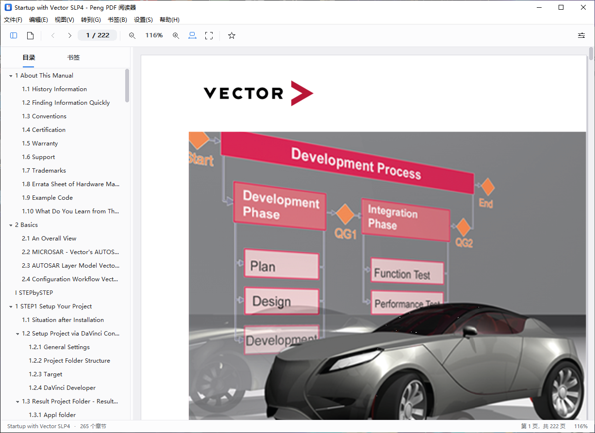
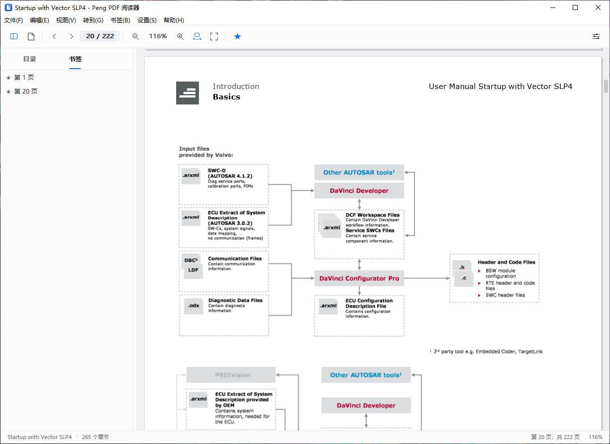
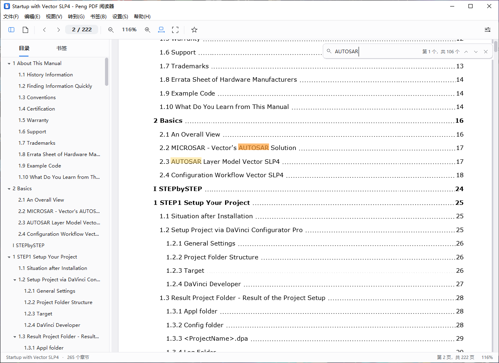
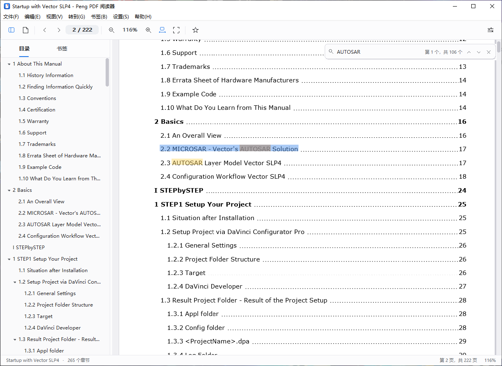
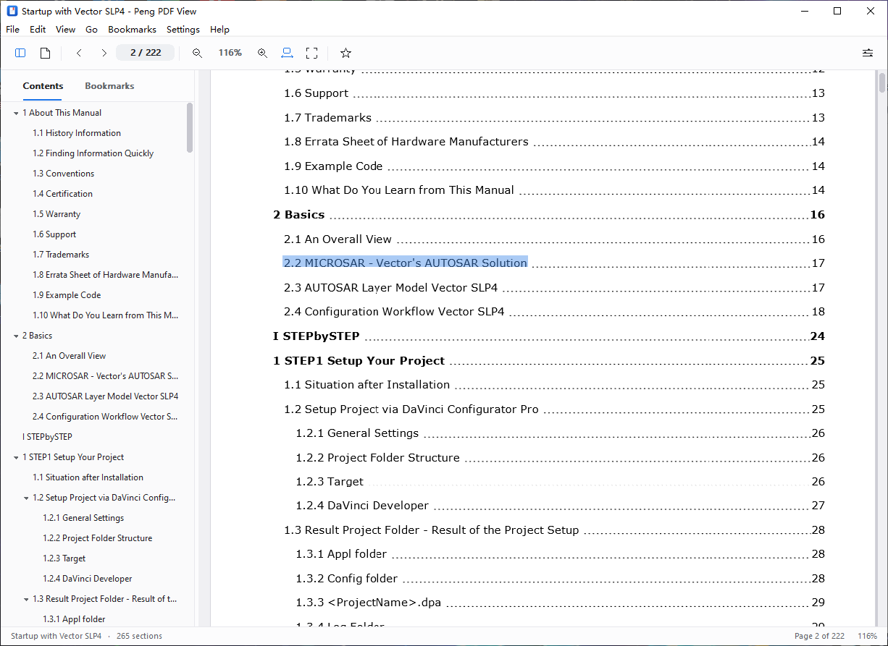
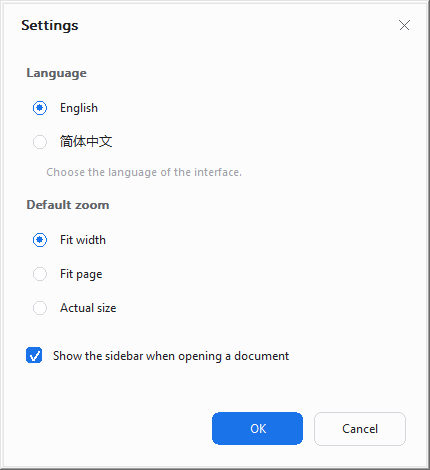
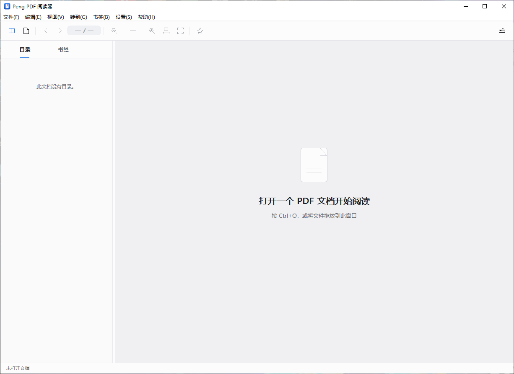

# Peng PDF View · PengPDFView

一个使用 **C++ / 原生 Win32** 编写的轻量级 PDF 阅读器。界面全部自绘，支持**中文 / 英文**双语切换、**PDF 目录（章节大纲）侧边栏**、**用户书签**、**全文搜索**与**文本选择复制**。最终以单个免安装的 `PengPDFView.exe`（x64，静态链接 C 运行库）交付。

> 渲染部分使用 Windows 自带的 PDF 引擎（`Windows.Data.Pdf`）以保证字体、中文、透明与图片的显示质量；PDF **文件结构解析**（交叉引用表 / 交叉引用流、对象流、页面树、书签树、命名目标、文档信息）以及**文字层**（内容流、字体编码、ToUnicode、字号与字宽、文本矩阵）均由本项目用 C++ 自行实现，包括自包含的 DEFLATE（zlib）解码器。没有引入任何第三方 PDF 库。



## 功能

> 完整的功能、交互细节与已知限制见 [docs/功能说明.md](docs/功能说明.md)。

- **PDF 阅读**：连续纵向滚动、缩放（适合宽度 / 适合页面 / 实际大小 / 15%–800%）、`Ctrl+滚轮` 以光标为中心缩放、鼠标中键拖拽平移、键盘翻页。
- **目录侧边栏**：解析 PDF 内部 `/Outlines` 书签树，按层级展示章节；可展开 / 折叠，点击跳转到对应页面；阅读时自动滚动并高亮当前章节。
- **书签**：为当前页添加 / 删除书签（工具栏星标、`Ctrl+D`、菜单均可），按文档分别保存，侧边栏「书签」标签页展示并可右键删除。
- **全文搜索**：`Ctrl+F` 打开浮动搜索栏，实时统计命中数量，`Enter` / `Shift+Enter` 在命中之间前后跳转；命中处按行高亮，当前命中以橙色强调；支持跨行匹配与忽略大小写。
- **文本选择与复制**：在页面上拖拽选择，`Ctrl+C` 复制纯文本；双击选词；选择按**阅读顺序**（自上而下、自左而右）组织，目录页等“绘制顺序与阅读顺序不一致”的文档也能正确选择。
- **中英文切换**：设置对话框或「设置 → 语言」菜单即时切换全部界面文字（菜单、工具栏提示、侧边栏、搜索栏、状态栏、对话框、错误提示），选择持久化保存。
- **设置**：默认缩放方式、打开文档时是否显示侧边栏、界面语言；窗口位置与大小、侧边栏宽度自动记忆。
- **最近打开**：文件菜单中的最近文档列表（最多 8 个）。
- **其它**：拖放打开文件、命令行打开文件、页面渲染缓存、高 DPI（Per-Monitor V2）适配、无依赖的自绘主题。

## 截图

| 目录侧边栏（中文） | 书签（中文） |
| --- | --- |
|  |  |

| 全文搜索（106 处命中） | 文本选择与复制 |
| --- | --- |
|  |  |

| 英文界面 | 设置（语言切换） |
| --- | --- |
|  |  |



## 构建

要求：Windows 10/11 x64；Visual Studio 2022 或 2026（安装「使用 C++ 的桌面开发」工作负载，含 MSVC 与 Windows 10/11 SDK）。

```bat
build.bat          :: 生成 bin\PengPDFView.exe
build.bat test     :: 生成并运行解析 / 文字层测试 bin\pdf_tests.exe（可选）
build.bat clean    :: 清理构建产物
```

`build.bat` 通过 `vswhere.exe` 自动定位 Visual Studio，使用 `cl.exe` 与 `rc.exe` 直接编译，把所有 `.cpp` 与资源编译链接为一个静态运行库（`/MT`）的可执行文件，无需任何第三方库。

当前验证环境：Windows 10 22H2 x64（19045）、Visual Studio 2026（MSVC 14.51）、Windows SDK 10.0.26100，构建产物约 682 KB。

## 使用

- 打开：`Ctrl+O`、文件菜单、把 PDF 拖到窗口，或启动时附带文件路径（`PengPDFView.exe "D:\docs\a.pdf"`）。
- 翻页：`PgUp` / `PgDn`、`Home` / `End`、工具栏前后按钮；`Ctrl+G` 跳转到指定页。
- 缩放：`Ctrl+1` 适合宽度、`Ctrl+2` 适合页面、`Ctrl+0` 实际大小、`Ctrl+=` / `Ctrl+-` 放大缩小、`Ctrl+滚轮` 以光标为中心缩放。
- 搜索：`Ctrl+F` 打开搜索栏并输入关键词；`Enter` 下一个、`Shift+Enter` 上一个、`Esc` 关闭。若打开搜索前选中了单行文字，会自动作为关键词。
- 选择：左键拖拽选择，双击选词，`Ctrl+C` 复制，`Esc` 清除选择；鼠标中键拖拽平移页面。
- 书签：`Ctrl+D` 添加 / 取消当前页书签、`Ctrl+Shift+D` 删除当前页书签；侧边栏「书签」页内右键可删除。
- 侧边栏：`F4` 显示 / 隐藏；拖动分隔条调整宽度。
- 设置：`Ctrl+,` 或「设置 → 首选项」。

## 源码结构

代码按功能拆分，`main.cpp` 只负责启动与消息循环：

```
src/
  main.cpp                 入口：DPI、COM、控件注册、消息循环
  Core/
    Config.h               应用常量（版本、窗口类名、DPI 布局尺寸、缩放范围）
    Utf.h/.cpp             UTF-8 / UTF-16 转换与字符串工具
    Paths.h/.cpp           %APPDATA%\PengPDFView 数据目录
    FileUtil.h/.cpp        文件读取、路径规范化
    Log.h/.cpp             诊断日志
  Pdf/
    PdfTypes.h/.cpp        PDF 对象模型、文本字符串解码（UTF-16BE / PDFDocEncoding）
    PdfDeflate.h/.cpp      自包含的 DEFLATE / zlib 解码器
    PdfFilters.h/.cpp      流过滤器（PNG/TIFF 预测器、ASCIIHex、ASCII85）
    PdfParser.h/.cpp       词法分析、交叉引用表 / 流、对象流、页面树、文档信息、损坏文件恢复
    PdfOutline.h/.cpp      书签树遍历、命名目标解析、目标页映射
    PdfTextTypes.h/.cpp    文字层数据模型（归一化字形框、页面文本、命中矩形合并）
    PdfFont.h/.cpp         字体解码：编码表 / Differences / ToUnicode CMap / 字宽
    PdfTextExtractor.h/.cpp 内容流解释器：文本状态、Tj/TJ、Form XObject、内联图片
  Text/
    TextSearch.h/.cpp      页面搜索索引：空白归一化、大小写折叠、命中映射
    TextSelection.h/.cpp   阅读顺序（VisualOrder）、按行命中测试、选词、选区矩形
    TextService.h/.cpp     文字提取与搜索的工作线程、LRU 页面缓存、消息回传
  Render/
    RenderService.h/.cpp   渲染工作线程：Windows.Data.Pdf + WIC，异步回传页面位图
  App/
    Commands.h             菜单 / 工具栏命令 ID
    Localization.h/.cpp    中英文界面字符串表与语言切换
    Settings.h/.cpp        设置持久化（INI）
    Bookmarks.h/.cpp       书签持久化（TSV，按文档分组）
  Ui/
    Theme.h/.cpp           调色板、字体、DPI、GDI 绘制与半透明填充
    UiMessages.h           自定义窗口消息
    ScrollBar.h/.cpp       通用细滚动条（可悬浮、可拖拽）
    Toolbar.h/.cpp         自绘工具栏与矢量图标
    Sidebar.h/.cpp         目录 / 书签侧边栏
    SearchBar.h/.cpp       浮动搜索栏（输入、命中计数、上一个 / 下一个 / 关闭）
    PageCanvas.h/.cpp      页面画布：布局、缩放、滚动、位图缓存、搜索高亮、文本选择
    Dialogs.h/.cpp         模态对话框框架、设置对话框、跳转页面对话框
    MainWindow.h/.cpp      主窗口：菜单、布局、命令、文档与搜索状态
res/                       图标、清单（Per-Monitor V2 DPI）、版本信息
tests/                     解析、文字层、搜索与选择几何测试
docs/                      截图
```

## 实现要点

**渲染**：`RenderService` 在专用 MTA 线程中加载 `Windows.Data.Pdf.PdfDocument`，逐页 `RenderToStreamAsync` 输出 PNG，再用 WIC 解码为 32 位 BGRA 位图，通过 `PostMessage` 交回 UI 线程；UI 线程只用 `StretchDIBits` 绘制。渲染请求按可见页优先级排队，重复请求自动合并，缩放 / 关闭文档时取消过期请求。页面位图使用 LRU 缓存（最多 12 页）。

**解析**：`Document` 常驻整个文件于内存，支持经典交叉引用表、交叉引用流、增量更新（`/Prev`）、混合引用（`/XRefStm`）与对象流（`/ObjStm`）。若交叉引用数据损坏，会扫描全文 `N G obj` 序列重建偏移表并寻找 Catalog，尽可能恢复文档。目录解析支持 `/Outlines` 树、`/Dest` 数组、`/A << /S /GoTo >>` 动作以及 `/Names /Dests` 命名目标树，并将目标对象号映射到页面序号。

**文字层**：`TextExtractor` 自行解释页面内容流——图形状态与 CTM（`q/Q/cm`）、文本对象与文本矩阵（`BT/ET/Tm/Td/TD/T*`）、文本状态（`Tf/Tc/Tw/Tz/TL/Ts`）以及 `Tj/TJ/'/"`；同时处理 Form XObject 中的文字与内联图片（`BI/ID/EI`）的跳过。字符到 Unicode 的映射优先使用字体自带的 ToUnicode CMap，简单字体回退到 WinAnsi/MacRoman/Standard 编码与 `/Differences` 字形名。字宽来自 `/Widths`、`/W`、`/DW`、`/MissingWidth` 或 Type3 的 `/FontMatrix`。最终坐标按 CropBox 归一化并按 `/Rotate` 旋转，得到与屏幕位图完全对齐的 0–1 字形框。

**搜索**：`PageTextIndex` 把一页字形压平成“空白归一化 + 大小写折叠”的字符串，并记录每个字符对应的字形序号。这样换行、缺失空格、大小写都不会影响匹配；命中结果映射回字形范围后按行合并成高亮矩形。搜索由 `TextService` 在工作线程中逐页执行，结果边搜边回传，UI 不会阻塞。

**选择**：PDF 内容流顺序不一定等于阅读顺序（典型例子是目录页先画标题、再画页码）。`VisualOrder` 把字形按视觉行分组并自上而下、自左而右排序；命中测试先选行、再选水平位置，因此拖到行尾不会跳到上一行。选择、复制文本和选区高亮都基于这一顺序。文字页按需提取并缓存（最多 64 页）。

**重绘与性能**：画布复用一个与客户区等大的后备位图，只在窗口尺寸变化时重建；`WM_PAINT` 仅绘制并 `BitBlt` 脏矩形，选区变化、搜索高亮和单页渲染完成都只重绘各自页面。可见页范围通过页面 top 的二分查找获得，绘制、滚动和鼠标命中不再随页数线性增长。搜索命中按页追加，只失效新增高亮的页面；查询只在开始时归一化一次。222 页手册的参考数据：结构解析约 14 ms、全文文字提取约 106 ms、全量搜索核心约 3 ms、端到端约 110 ms；持久后备位图消除了每帧约 1.6 ms 的 GDI 位图分配。

**线程与生命周期**：所有 WinRT 对象只在渲染线程中创建和销毁；解析器的对象缓存由内部互斥量保护，供 UI 与文字线程共享同一个 `Document`。文档用递增 token 标识，关闭 / 重新打开后迟到的渲染或文字结果会被丢弃。UI 线程不阻塞在渲染或全文搜索上。

**本地化**：所有可见文字来自 `Localization.cpp` 的字符串表，`Tr(Str::Id)` 取当前语言文本；切换语言会重建菜单、控件字体并重绘，页面位图与文字缓存保持不变。中文界面使用 Microsoft YaHei UI，英文使用 Segoe UI。

**DPI**：清单声明 Per-Monitor V2；所有尺寸经 `theme::Scale(dip, dpi)` 换算，`WM_DPICHANGED` 时重建字体与布局，页面按新的物理像素宽度重新渲染。

## 数据文件

```
%APPDATA%\PengPDFView\settings.ini      窗口、语言、缩放、侧边栏、最近文件
%APPDATA%\PengPDFView\bookmarks.tsv     按文档保存的书签（UTF-8）
%APPDATA%\PengPDFView\pengpdfview.log   诊断日志（自动截断）
```

删除该目录即可恢复出厂设置，不会修改任何 PDF 文件本身。

## 测试

```bat
build.bat test
bin\pdf_tests.exe "D:\docs\a.pdf" "D:\docs\b.pdf"
```

测试分为四组：

1. **DEFLATE 解码**：zlib 生成的动态哈夫曼流、存储块流、空流与无 zlib 头的裸 DEFLATE 流逐字节比对；
2. **合成页面搜索**：大小写、跨行、多余空白、命中范围与高亮矩形；
3. **阅读顺序与选择几何**：打乱字形顺序后的行排序、行内命中测试、选词范围、按行合并矩形；
4. **真实文档**：页数、元数据、目录树、页面尺寸、首页文字提取、字形框范围，以及“提取出的文字能被搜索索引命中”的端到端校验。

已在中文 PDF、222 页英文手册（265 条目录）、压缩对象流（`/ObjStm`）与损坏文件等样本上验证通过。

## 已知限制

- 不支持加密（需要密码）的 PDF，打开时会提示受密码保护；暂未提供密码输入。
- 暂不支持注释、打印、缩略图与页面旋转。
- 文本选择一次只覆盖一页；跨页选择尚未实现。
- 扫描版 PDF 没有文字层，搜索无结果、无法选择——这是文档本身的限制。
- 少数 CID 字体若既没有 ToUnicode、又使用非 Identity 编码，文字可能无法还原；目录与搜索此时会跳过这些字形。
- 目录文字依赖 PDF 内部字符串编码（支持 UTF-16BE/LE、UTF-8 BOM 与 PDFDocEncoding）；非标准自定义编码可能显示为占位字符。
- 仅支持 Windows（依赖系统 PDF 引擎与 Win32/WIC API）。
- 整个 PDF 会读入内存，超 1 GB 的文件会被拒绝。

## 版本

`1.1.1` · 作者：Peng · 版权声明见 `res/PengPDFView.rc` 中的版本资源。
